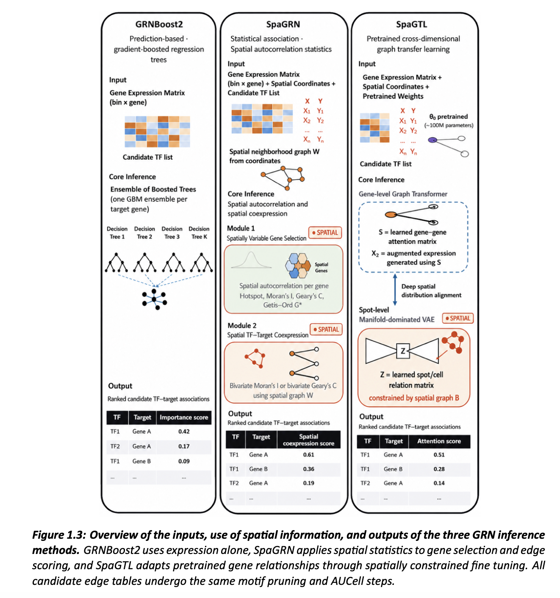
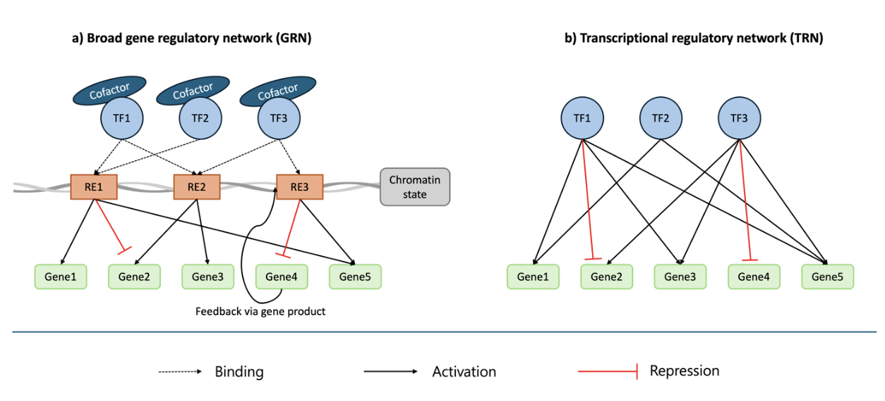
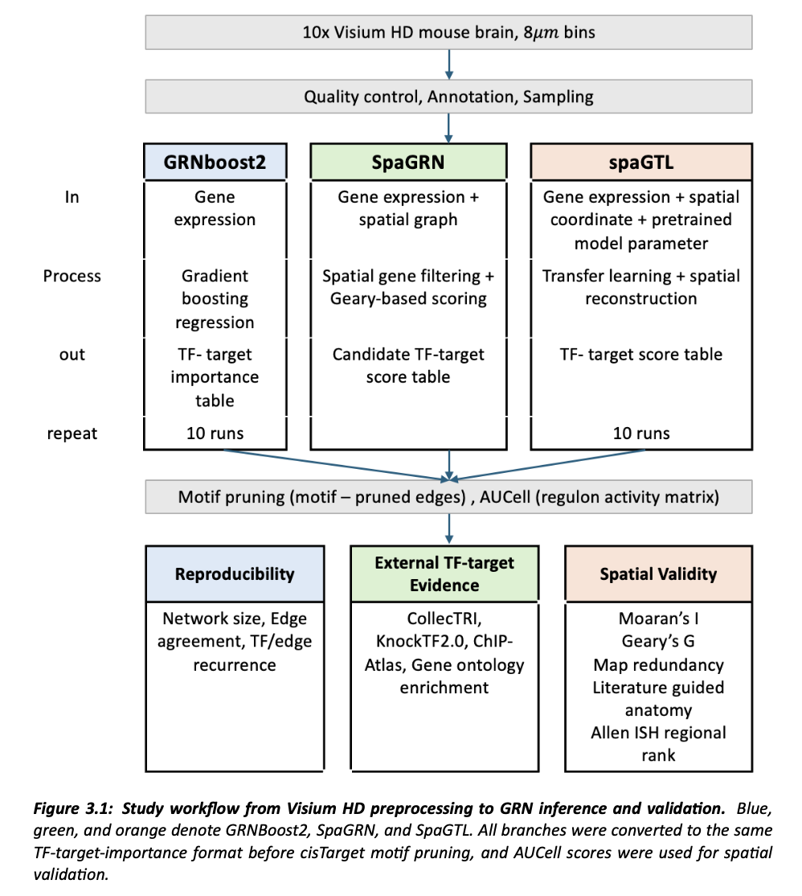
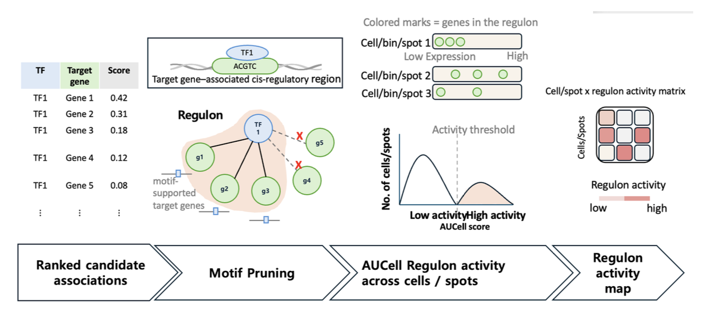

# Evaluating gene regulatory network inference for spatial transcriptomics

Master's thesis project by Chaeyoung Kim, MSc Bioinformatics, Ghent University, academic year 2025–2026.

**Computing environment:** Preprocessing and network inference ran on the Ghent University high-performance computing (HPC) cluster. The repository includes the original PBS batch scripts alongside the Python code. GRNBoost2 and SpaGRN used CPU jobs; SpaGTL training requested an NVIDIA GPU. Final comparison and validation were organized in Jupyter notebooks.

This project asks whether adding tissue location to gene regulatory network (GRN) inference produces more trustworthy transcription factor (TF)–target gene relationships. Three strategies were compared on the same 10x Genomics Visium HD mouse brain section: expression-only inference with GRNBoost2, spatial-statistics-based inference with SpaGRN, and spatially constrained transfer learning with SpaGTL.

The analysis focuses on transcriptional regulatory networks: TFs are connected to genes whose expression patterns are predicted to be regulated by them. This is a narrower view than a broad gene regulatory network, which can also include cofactors, regulatory elements, chromatin state, and feedback through gene products.

*The three methods differ in the information used during inference: expression alone for GRNBoost2, expression plus spatial structure for SpaGRN, and expression, spatial coordinates, and pretrained weights for SpaGTL.*

*Conceptual distinction between a broad gene regulatory network and the TF–target transcriptional networks evaluated here.*

The main conclusion is deliberately narrower than “spatial is more accurate.” Spatially informed methods produced more spatially organized target-gene programs and, in some comparisons, better agreement with broad anatomical expression patterns. They did not consistently improve edge reproducibility or support from independent regulatory evidence. Spatial organization and TF–target edge accuracy therefore need to be evaluated separately.

## Study design

The analysis used the public [Visium HD mouse brain fresh-frozen dataset](https://www.10xgenomics.com/datasets/visium-hd-cytassist-gene-expression-mouse-brain-fresh-frozen), processed by 10x Genomics with Space Ranger 3.1.1. The 8 µm binned output contained 453,797 bins and 19,059 genes. Quality control retained 378,185 bins and 16,051 genes. A stratified sample of 30,000 bins preserved transcriptional clusters and broad anatomical composition while keeping repeated genome-scale inference computationally feasible.

[MapMyCells](https://brain-map.org/our-research/cell-type-taxonomies/whole-mouse-brain-taxonomy) with the Whole Mouse Brain taxonomy CCN20230722 provided reference-based cell-type labels. All three inference methods then received the same sampled expression matrix and candidate TF list.

| Method | Information used during inference | Runs | Candidate edge score |
| --- | --- | ---: | --- |
| GRNBoost2 | Gene expression only | 10 | Importance in gradient-boosted regression |
| SpaGRN | Expression and spatial coordinates | 1 | Spatial co-variation between a TF and target |
| SpaGTL | Expression, coordinates, and pretrained weights | 10 | Attention-derived gene relationship score |

*Study workflow from spatial-transcriptomics preprocessing through network inference, common motif pruning and AUCell scoring, and downstream validation.*

Every candidate network passed through the same downstream steps. [pySCENIC](https://pyscenic.readthedocs.io/en/stable/) used cisTarget motif enrichment to retain motif-supported regulons, and AUCell summarized each regulon's target-gene activity in every bin.

*Candidate TF–target associations are motif-pruned, converted into regulons, scored with AUCell across bins, and represented as regulon activity maps. This common post-processing made the comparison focus on the inference stage rather than different downstream workflows.*

## How the networks were evaluated

There is no complete ground-truth regulatory network for this tissue. The evaluation therefore combined three questions that reveal different properties of an inferred network.

**Would the method return a similar network again?** Ten runs of GRNBoost2 and SpaGTL were compared using network-size variation, overlap of top-ranked edges, rank agreement among repeated edges, and consistency of the targets assigned to recurrent TFs. SpaGRN was deterministic in this workflow and was not included in the repeated-run comparison.

**Do the proposed relationships have independent biological support?** The edge rankings were compared with literature-curated regulatory relationships, gene-expression responses after TF removal, and TF binding near target genes. These references do not constitute interchangeable tests: they represent prior knowledge, functional response, and physical occupancy, respectively. An edge missing from one reference was treated as unsupported by that source, not automatically incorrect.

**Do the inferred target programs form interpretable tissue patterns?** AUCell maps were assessed for spatial coherence with Moran's I and Geary's C, and for similarity between different TF regulon maps. Broad-region activity was also compared with Allen Mouse Brain Atlas in situ hybridization (ISH) expression of the corresponding TF. This last comparison tests anatomical compatibility, not the correctness of individual TF–target edges.

## Main results

### Repeated runs did not recover one definitive edge list

GRNBoost2 was more stable across a broad part of the ranked network, whereas SpaGTL was most stable among its highest-ranked edges. In both stochastic methods, recovering the same TF across runs was more common than reconnecting that TF to exactly the same targets. A single run should therefore be interpreted as one network supported by the data, and recurrent edges are more suitable for downstream analysis.

### The strongest method depended on the biological evidence

All three methods recovered more reference-supported relationships than expected from random edge selection, although absolute precision remained low. GRNBoost2 received the strongest support from curated literature and TF-binding evidence. SpaGRN received the strongest support from expression changes after TF perturbation. The change in ranking reflects both the inferred networks and what each reference can observe; it does not identify a universally most accurate method.

### Spatial information helped reveal tissue organization, with an important limitation

Among the 22 TFs recovered by all methods, SpaGRN produced the strongest spatial clustering of regulon activity, followed by SpaGTL and GRNBoost2. Spatially informed maps were often more continuous and anatomically structured. SpaGTL also showed the most consistent broad-region agreement with Allen ISH TF expression, followed by SpaGRN.

That advantage was specific to spatial interpretation. Different SpaGRN regulons often produced similar broad tissue maps, with a median cross-regulon correlation of about 0.78, compared with about 0.25 for SpaGTL and approximately zero for GRNBoost2. Some GRNBoost2 regulons were spatially organized even though coordinates were never supplied, because co-expressed targets can concentrate in the same cell populations or regions. Strong spatial coherence therefore does not establish TF-specific regulation.

## Data and knowledge resources

The project used databases at distinct points in the workflow rather than treating them as one pooled validation set.

| Stage | Resource | How it was used |
| --- | --- | --- |
| Input data | [10x Genomics Visium HD mouse brain](https://www.10xgenomics.com/datasets/visium-hd-cytassist-gene-expression-mouse-brain-fresh-frozen) | Public fresh-frozen mouse brain section; 8 µm Space Ranger output used for the analysis |
| Annotation | [Allen Whole Mouse Brain taxonomy CCN20230722](https://brain-map.org/our-research/cell-type-taxonomies/whole-mouse-brain-taxonomy) through MapMyCells | Reference mapping of bins to cell types; labels were consolidated into broad anatomical regions |
| Candidate regulators | [Aerts Lab mouse TF list](https://resources.aertslab.org/cistarget/tf_lists/) | Restricted candidate regulators to known mouse TFs present in the expression matrix |
| Regulon construction | [Aerts Lab cisTarget mm10/refseq_r80 databases](https://resources.aertslab.org/cistarget/databases/mus_musculus/mm10/refseq_r80/) and motif-to-TF annotations | Removed candidate associations without motif enrichment support before AUCell scoring |
| Curated relationships | [CollecTRI through OmniPath](https://omnipathdb.org/) | Compared inferred relationships with a preprocessed mouse-symbol TF–target CSV; the checked files do not document how this CSV was downloaded or converted |
| Perturbation response | [KnockTF 2.0](https://pmc.ncbi.nlm.nih.gov/articles/PMC10767813/) | Asked whether target expression changed after the corresponding TF was knocked down or knocked out; mouse pairs with p < 0.05 were retained |
| Physical binding | [ChIP-Atlas Target Genes](https://chip-atlas.org/target_genes) | Asked whether public ChIP-seq data supported TF binding within ±5 kb of the target transcription start site |
| Functional interpretation | [g:Profiler](https://biit.cs.ut.ee/gprofiler/gost) | Gene Ontology biological-process enrichment for high-ranking consensus regulons, using the measured gene panel as background |
| External spatial reference | [Allen Mouse Brain Atlas ISH](https://brain-map.org/support/documentation/documentation-allen-mouse-brain-atlas) | Compared broad-region AUCell activity with independent TF transcript-expression energy across cerebral cortex, cerebral nuclei, and interbrain |

### Database integration in the analysis

Database use in this project went beyond collecting reference lists. Each resource answered a different biological question, so identifiers, species, eligible TFs and genes, and statistical thresholds were harmonized before comparison. Curated regulatory knowledge, perturbation responses, and physical binding evidence were evaluated separately because absence from one source can reflect limited coverage rather than evidence against an inferred relationship. Reference-specific baselines were therefore used to measure enrichment fairly instead of pooling unlike forms of evidence.

This evidence-aware integration connected public spatial-transcriptomics data and a brain cell taxonomy to motif-ranking databases, regulatory-network knowledge, perturbation experiments, ChIP-seq collections, functional ontologies, and an independent spatial atlas. It enabled the project to assess both biological plausibility and spatial interpretability while retaining the limitations and meaning of each database.

## Repository contents

The six folders below follow the analysis from raw spatial data to validation. Each folder explains its Python files, PBS jobs, required inputs, and software. Folder numbers label stages; the original script numbers are retained inside them.

| Analysis group | Files | Purpose |
| --- | --- | --- |
| 00 · Preparation | [`pipeline/00_preprocessing_annotation/`](pipeline/00_preprocessing_annotation/) | Quality control, filtering, and brain cell-type labels |
| 01 · Sampling | [`pipeline/01_sampling_inputs/`](pipeline/01_sampling_inputs/) | Choose and check 30,000 bins; prepare common inputs |
| 02 · GRNBoost2 | [`pipeline/02_grnboost2/`](pipeline/02_grnboost2/) | Infer expression-only networks and score regulons |
| 03 · SpaGRN | [`pipeline/03_spaGRN/`](pipeline/03_spaGRN/) | Infer spatial networks and score regulons |
| 04 · SpaGTL | [`pipeline/04_spaGTL/`](pipeline/04_spaGTL/) | Fine-tune the spatial model and score regulons |
| 05 · Validation | [`pipeline/05_validation/`](pipeline/05_validation/) | Compare repeatability, independent evidence, and tissue patterns |

Notebook outputs were cleared to keep the files small enough for GitHub to render. The analysis code and explanatory markdown are unchanged; the main result figures are shown above. Each notebook currently defines an absolute `BASE` path near the top. Change that path to the local analysis directory before running it.

## HPC execution and software

The `.pbs` files record the batch jobs submitted to the Ghent University HPC cluster, including requested CPU cores, memory, wall time, environment setup, and command lines. Preprocessing used `visium_qc`; GRNBoost2 and motif/AUCell jobs used `pyscenic_env`; SpaGRN inference used `spagrn_env`; SpaGTL training used a separate `spagtl_env` with one NVIDIA GPU and CUDA 12.1.1. The downstream validation notebooks use locally stored HPC outputs and external reference data.

The main inference tools were [Arboreto/GRNBoost2](https://github.com/aertslab/arboreto), [SpaGRN](https://github.com/BGI-Qingdao/SpaGRN), [SpaGTL](https://github.com/zccqq/SpaGTL), and [pySCENIC](https://github.com/aertslab/pySCENIC). Each stage's folder README identifies its other important packages and input files.

Exact package versions were not captured in a portable lock file. The PBS scripts preserve the original HPC environment names and resource requests, and several scripts contain project-specific absolute paths under `/data/gent/...`. Update those paths before attempting a full rerun.

## Interpretation and limitations

The analysis used one section from one mouse. The 8 µm bins approach cellular scale but are not segmented cells, so a bin can divide one cell or mix transcripts from neighboring cells. The comparison also tested three complete pipelines, not isolated versions of one algorithm with and without coordinates. The inferred regulons are therefore candidates for follow-up experiments, not confirmed regulatory relationships.

For future validation, the highest-priority candidates are relationships that recur across runs, receive support from an independent regulatory source, and form a spatial pattern that can be interpreted in the relevant tissue context.
